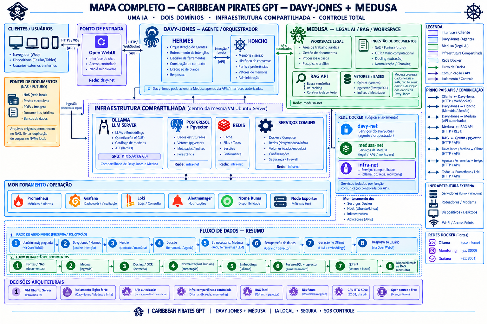

# Projeto Medusa

> **Ambiente de recuperação de evidências documentais com grounding conservador, administração autenticada e rastreabilidade de prova.**
> Projeto ativo desde **17/09/2026** · Ambiente de laboratório em produção controlada · Geração jurídica **desabilitada por decisão de projeto**.

[](#estado-atual)
[](#host)
[](#fronteira-legal)

## Mapa completo da arquitetura



---

## Índice

1. [Visão geral](#1-visão-geral)
2. [Host e infraestrutura](#2-host-e-infraestrutura)
3. [Arquitetura](#3-arquitetura)
4. [Estado atual](#4-estado-atual)
5. [O que já foi implementado](#5-o-que-já-foi-implementado)
6. [O que está em andamento](#6-o-que-está-em-andamento)
7. [O que falta implementar](#7-o-que-falta-implementar)
8. [O que deu errado](#8-o-que-deu-errado)
9. [O que desistimos de fazer](#9-o-que-desistimos-de-fazer)
10. [Linha do tempo e tempo de projeto](#10-linha-do-tempo-e-tempo-de-projeto)
11. [Estimativa para conclusão](#11-estimativa-para-conclusão)
12. [Estrutura do repositório](#12-estrutura-do-repositório)
13. [Operação](#13-operação)
14. [Qualidade e testes](#14-qualidade-e-testes)
15. [Observabilidade e backup](#15-observabilidade-e-backup)
16. [Segurança e fronteira legal](#16-segurança-e-fronteira-legal)
17. [Riscos](#17-riscos)
18. [Glossário](#18-glossário)
19. [Referências](#19-referências)

---

## 1. Visão geral

O **Medusa** é o domínio de evidência do laboratório: um corpus documental **imutável e com proveniência verificada**, consultado por **recuperação literal com citação**, sem geração de conclusão jurídica. O **Davy-Jones** é a camada de administração: interface autenticada, fila durável de trabalho, cadastro de pessoas e preparação de minutas para revisão humana.

O sistema é **deliberadamente conservador**: ele responde *"onde está a prova"* e devolve trechos com citação, nunca *"qual é a resposta jurídica"*. Isso é registrado em todo contrato de API como `REVIEW_REQUIRED` / `ABSTAIN`, e a geração está permanentemente desligada (`generation_enabled = false`).

**Princípios de projeto:**

| Princípio | Concretização |
|---|---|
| Corpus canônico imutável | Recuperação canônica é **somente leitura**; SHA-256 e contagem verificados em toda consulta |
| Workspace separado | Novos documentos entram em **revisões imutáveis** com coleção Qdrant própria; nada sobrescreve o canônico |
| Falha fechada | Erro de conversão, OCR ou dependência **rejeita** o documento em vez de indexar lixo |
| Proveniência | Todo trecho carrega documento, página, chunk e hash de origem |
| Geração desabilitada | Nenhum modelo gera conclusão jurídica; apenas *drafts* extrativos para revisão |
| Limite de acesso | Tudo em `127.0.0.1`; acesso remoto via SSH autenticado + token |

---

## 2. Host e infraestrutura

| Item | Valor |
|---|---|
| SO | Ubuntu 26.04.1 LTS |
| Kernel | 7.0.0-38-generic |
| CPU | 30 vCPU |
| Memória | 22 GiB utilizáveis |
| Disco | 735 GB (12% usado, 619 GB livres) |
| GPU | NVIDIA RTX 5090 32 GB (Docling) |
| Conta operadora | `tlandskron` (UID 1000), *systemd lingering* habilitado |
| Instalação | **100% de usuário** — nada em `/opt`, `/etc` ou `/var/lib`; estado de containers em `/var/lib/docker/volumes` |

### Serviços systemd (usuário)

| Unidade | Função | Agenda |
|---|---|---|
| `medusa-core.service` | Recuperação de evidências | contínuo — `127.0.0.1:8765` |
| `davy-jones.service` | Administração, fila e interface | contínuo — `127.0.0.1:8766` |
| `medusa-rag-worker.service` | Fila durável de ingestão | contínuo — `127.0.0.1:8767` |
| `medusa-caddy.service` | Proxy LAN e TLS local | contínuo — 3000/3443/5080 |
| `medusa-davy-health.timer` | Registro de *readiness* | a cada 5 min |
| `medusa-davy-backup.timer` | Backup do aplicativo | diário ~03:30 |
| `medusa-remote-backup.timer` | Replicação SMB | horária |

**9 containers em execução · 4 serviços ativos · 3 timers · 0 falhas systemd.**

### Containers

| Container | Imagem | Papel |
|---|---|---|
| `medusa-docling` | `docling-serve-cu130:v1.34.0` | Conversão PDF/OCR em GPU (`:5001`) |
| `infra-qdrant` | `qdrant/qdrant:v1.19.1` | Vector store (`:6333`) |
| `u0137-ollama` | `ollama/ollama:latest` | Embeddings e modelos locais |
| `medusa-searxng` | `searxng/searxng` | Busca web interna (`:8081`) |
| `obs-prometheus` | `prom/prometheus:v3.7.3` | Métricas (`:9090`) |
| `obs-grafana` | `grafana/grafana:12.3.1` | Dashboards (`:3000`) |
| `obs-node-exporter` | `prom/node-exporter:v1.9.1` | Métricas de host (`:9100`) |
| `infra-postgres` | `pgvector/pgvector:0.8.6-pg18` | PostgreSQL (ocioso — ver §9) |
| `infra-redis` | Redis (build local) | Cache (ocioso — ver §9) |

### Qdrant — 12 coleções, 1.850 pontos

| Coleção | Pontos | Papel |
|---|---:|---|
| `medusa_rag_chunks_v1` | 206 | **Corpus canônico** (imutável) |
| `medusa_structured_docs_v1` | 625 | Representação estruturada |
| `medusa_docs_v1` | 30 | Metadados de documentos |
| `medusa_workspace_*` (5) | 879 | Revisões imutáveis de ingestão |
| `hermes_eng_memory_v2` | 92 | Memória do Hermes (legado) |
| `davy_jones_mem0_v1` | 3 | Memória operacional Mem0 |

---

## 3. Arquitetura

```
                         ┌──────────────────────────────────────────────┐
   PDF / TXT / MD  ───►  │  documents/incoming/  (inbox, sem watcher)   │
                         └───────────────────────┬──────────────────────┘
                                                 │  seleção explícita
                                                 ▼
                         ┌──────────────────────────────────────────────┐
                         │  Davy-Jones :8766  ──►  RAG Worker :8767     │
                         │  (autenticação + fila SQLite)                 │
                         └───────────────────────┬──────────────────────┘
                                                 ▼
                         ┌──────────────────────────────────────────────┐
                         │  medusa-core ingest                          │
                         │   ├─ Docling  (conversão + OCR, GPU)         │
                         │   ├─ Ollama   (qwen3-embedding:4b, 2560d)    │
                         │   └─ Qdrant   (coleção por revisão)         │
                         └───────────────────────┬──────────────────────┘
                                                 ▼
                         ┌──────────────────────────────────────────────┐
                         │  workspace/revisions/<sha256>/  (imutável)   │
                         │  workspace/index.json          (publicação)  │
                         └───────────────────────┬──────────────────────┘
                                                 ▼
        consulta ──► medusa-core :8765 ──► trechos + citação + estado
                  └► davy-jones :8766 ──► jobs, minutas, cadastro

   Evidência:  ~/log/  +  ~/txt/  +  ~/medusa/backups/  ──►  SMB remoto
   Observabilidade:  Prometheus + Grafana + node-exporter (LAN)
```

**Regra de ouro de dados:** `documents/incoming` é **entrada**; `workspace/revisions` é **saída imutável**; `backups` é **cópia**; `data` e `artifacts` são **laboratório**. Esses papéis nunca se misturam.

---

## 4. Estado atual

### Matriz de status

| Domínio | Estado | Evidência |
|---|---|---|
| Recuperação canônica | 🟢 **Operacional** | 206 pontos verificados, `/ready` OK |
| Ingestão em workspace | 🟢 **Operacional** | 5 revisões, 879 pontos, publicação atômica |
| Fila durável (RAG Worker) | 🟢 **Operacional** | SQLite WAL, retries limitados, lock de instância única |
| Administração autenticada | 🟢 **Operacional** | 1 ADMIN + 1 USER, token 0600, loopback |
| Backup do aplicativo | 🟢 **Operacional** | 31 backups completos, verificação + réplica SMB |
| Observabilidade | 🟡 **Parcial** | Prometheus/Grafana OK; sem Loki/Alertmanager/métricas de app |
| Retenção de backup | 🔴 **Pendente** | Sem política de expiração (crescimento linear) |
| Coleta de lixo de revisões | 🔴 **Pendente** | Sem GC; revisões acumulam |
| Cadastro (pessoas/rótulos) | 🔴 **Degradado** | 3 pessoas, **0 rótulos**, **0 histórico** (incidente R1.1) |
| Autenticação humana (LAN) | 🟡 **Em implantação** | `MEDUSA-UI-AUTH-01` em andamento |
| Geração jurídica | ⛔ **Desabilitada** | Decisão de projeto — ver §16 |
| M5.25+ | ⛔ **Não autorizado** | Aguardando autorização formal |

### Verificação ao vivo (21/10/2026)

- 9/9 containers `running`; 4/4 serviços `active`; 3/3 timers `active`.
- `/ready` do Medusa e do Davy-Jones: **prontos**.
- Prometheus: **2/2 alvos UP**; Grafana 12.3.1 com dashboard de 11 painéis.
- Último backup: `state = COMPLETE`; réplica remota `ALREADY_VERIFIED`.

---

## 5. O que já foi implementado

### Medusa (recuperação)

- [x] Corpus canônico imutável com verificação de SHA-256, contagem, métrica e dimensão.
- [x] Recuperação literal com citação (documento, página, chunk, hash) e limite de 50 candidatos.
- [x] Contrato de API com estados `REVIEW_REQUIRED` / `ABSTAIN` e `generation_enabled = false`.
- [x] Ingestão incremental em workspace: conversão PDF (Docling), chunking por página, embeddings 2560d.
- [x] Publicação atômica de revisões com validação de contagem, saúde e recuperação real.
- [x] Fila durável de ingestão (`RAG Worker`) com idempotência, retries e recuperação pós-interrupção.
- [x] Hardening do servidor HTTP: loopback, rejeição de CORS, limites de conexão e corpo, timeout por backend.
- [x] Busca web interna isolada (SearXNG) com motores limitados e sem dependência de Redis.

### Davy-Jones (administração)

- [x] Autenticação por token de administração + autenticação humana (sessões, CSRF, rate-limit, argon2).
- [x] Fila de trabalho persistente com estados `queued/running/succeeded/failed/cancelled`.
- [x] Cadastro Universal (pessoas, rótulos, vínculos) com histórico.
- [x] Grounding jurídico conservador, plano de pesquisa, extração de fatos e pacote de revisão.
- [x] Ferramentas: web_search, OCR local, geração determinística de DOCX, integração Mem0.
- [x] Interface única Medusa + Davy-Jones com fluxo de ingestão e seleção de corpus de workspace.

### Infraestrutura e operação

- [x] Composição de containers com limites de recurso, healthchecks e redes dedicadas.
- [x] Proxy LAN (Caddy) com TLS local e encaminhamento autenticado.
- [x] Backup diário do aplicativo com manifestação, verificação e marcador `COMPLETE`.
- [x] Replicação remota SMB sobre Tailscale, horária, com verificação de integridade.
- [x] Stack de observabilidade (Prometheus + Grafana + node-exporter) provisionada.
- [x] Hardening de rede e auditoria de portas (relatórios em `docs/auditoria/`).

### RAG / pipeline (M5)

- [x] M5.1–M5.10: extração, representação estruturada, chunking e validação — **M5.10 fechado** com estratégia `C_FLOW_BALANCED` congelada.
- [x] M5.11/M5.12: materialização do fluxo C e validação de embeddings.
- [x] M5.13/M5.14: validação pré-índice e indexação controlada no Qdrant.
- [x] M5.15–M5.19: validação de recuperação semântica, redundância/diversidade e consolidação de evidências.
- [x] M5.20–M5.23: especificação de recuperação consolidada, contrato de integração, adaptador e **construtor de contexto** — **M5.23 congelado**.
- [x] M5.24: diagnósticos D1–D9 e experimentos E1–E2 (comparação e benchmark de `bge-m3`).

---

## 6. O que está em andamento

| Item | Estágio | Observação |
|---|---|---|
| `MEDUSA-UI-AUTH-01` — acesso humano via LAN | implantação | Autenticação humana; requer revisão de contrato |
| Reconstrução do cadastro de rótulos | pendente de autorização | Perdido no incidente R1.1 (ver §8) |
| Retenção de backup e poda de staging | design | Ver §7 e §11 |
| Coleta de lixo de revisões de workspace | design | Sem GC hoje |
| Métricas de aplicação/container | design | Hoje só há métricas de host |
| Execução/validação da etapa M5.24-R1 | revisão obrigatória | Não congelada (ver §8) |

---

## 7. O que falta implementar

### Bloqueadores técnicos

1. **Autorização formal das etapas M5.25+** — hoje `NOT_AUTHORIZED`.
2. **Execução e validação da implementação de produção M5.24-R1** (os diagnósticos D1–D9 e E1–E2 já estão concluídos).
3. **Reconstrução do cadastro de rótulos** do Cadastro Universal (3 pessoas, 0 rótulos, 0 histórico).
4. **Política de retenção de backup** — 31 conjuntos, ~121 MB cada, crescimento diário sem expiração.
5. **Coleta de lixo de revisões** — 5 revisões hoje; cada ingestão acrescenta uma, sem remoção.
6. **Observabilidade completa** — Loki (logs), Alertmanager (alertas) e métricas de aplicação/container.
7. **Autenticação humana em produção** — concluir o contrato e a implantação do `MEDUSA-UI-AUTH-01`.
8. **Métricas e SLOs** — hoje não há SLO nem alerta de degradação.
9. **Retenção/poda do staging de replicação** (`.local/state/medusa-remote-backup/archives`, 28 pacotes / 1,2 GB).
10. **Limpeza de dívida de infraestrutura** — PostgreSQL/pgvector e Redis ociosos (ver §9).

### Estrutural

- Testes de carga e de falha (kill -9, interrupção de ingestão, restauração completa).
- Documentação de runbook por sintoma (existe material bruto; falta a versão publicável).
- Cópia de backup independente (nuvem ou mídia offline) — hoje há apenas SMB remoto.

---

## 8. O que deu errado

| # | Incidente | Causa | Consequência | Estado |
|---|---|---|---|---|
| 1 | **Rótulos do Cadastro perdidos** | Testes R1.1 alteraram o estado do registry | 3 pessoas, **0 rótulos**, **0 histórico** | 🔴 Reconstrução pendente de autorização |
| 2 | **M5.24-R1 não congelada** | Exigência de revisão humana não concluída | Etapa de produção travada | 🟡 Aguardando revisão |
| 3 | **M5.25+ bloqueado** | Não autorizado formalmente | Pipeline de geração não avança | ⛔ Aguardando autorização |
| 4 | **Observabilidade incompleta** | Escopo inicial cobriu só host | Sem Loki, Alertmanager e métricas de app | 🟡 Em design |
| 5 | **Grafana "em :6001"** | Documentação divergente do deploy real | Acesso efetivo é `127.0.0.1:3000` via túnel | 🟢 Documentado neste README |
| 6 | **13 falhas de login em 7 dias** | Tentativas inválidas + rate-limit | Nenhum bloqueio permanente | 🟢 Rate-limit ativo |
| 7 | **Segredo encontrado dentro de SQLite** | Credencial registrada em base de dados | Higienização posterior (chave arquivada) | 🟢 Corrigido |
| 8 | **Token OAuth expirado no GCM** | Entrada `gho_…` sem validade | API retorna 401; PAT clássico usado | 🟢 Workaround ativo |
| 9 | **DNS do PC com IP morto do GitHub** | `140.82.114.4` em cache | `git` funciona, API às vezes falha | 🟡 Mitigado |
| 10 | **Suíte de testes exige venv** | `python3` do sistema (3.14) não tem `docx`/`PIL`/`argon2` | 28 erros de import ao rodar fora do venv | 🟢 Documentado em §14 |

> **Ponto de atenção atual:** a suíte do Davy-Jones passa **266/266** com `.venv-mem0/bin/python3.11`, mas **falha com 28 erros** usando o `python3` do sistema. Sempre usar o venv (§14).

---

## 9. O que desistimos de fazer

| Item | Motivo da desistência |
|---|---|
| **PostgreSQL/pgvector como vector store** | Qdrant já atende; Postgres ficou ocioso (72 MB) |
| **Redis em uso direto pelas aplicações** | Cache do SearXNG é próprio, em disco; Redis ficou ocioso |
| **Nginx / porta 443** | Caddy atende o proxy LAN com TLS local; sem exposição pública |
| **Open WebUI** | Interface própria (Medusa + Davy-Jones) já cobre o caso de uso |
| **Honcho como orquestrador ativo** | Substituído pelo RAG Worker; backups históricos preservados |
| **Laboratório MEDUSA-AEL (multiagente)** | Sandbox encerrado; produção segue com RAG conservador |
| **Runtime nativo do Codex** | Migrado; histórico preservado em `.codex` |
| **Geração jurídica por LLM** | Decisão de projeto: só *drafts* extrativos com revisão humana |

> **Nota de higiene:** o legado pesa ~5,7 GB (`.codex` 3,1 GB + `.hermes` 2,5 GB + `old` + `medusa-ael`) contra ~3,8 GB de aplicação viva. É o principal candidato a arquivamento, nunca `workspace/`, `documents/` ou `backups/`.

---

## 10. Linha do tempo e tempo de projeto

**Início do projeto: 17/09/2026** (primeiro acesso e instalação do host).
**Data desta documentação: 21/10/2026.**
**Tempo de projeto: 34 dias (~5 semanas).**

| Período | Marcos |
|---|---|
| **17–20/09** | Instalação do host, primeiro acesso, base do runtime |
| **21–25/09** | Pipeline de extração, embeddings e início do M5 (M4.x/M5.1) |
| **25–29/09** | M5.1–M5.24-E2: estrutura, chunking, indexação, contexto, diagnósticos e benchmark |
| **30/09** | Laboratório MEDUSA-AEL (encerrado) |
| **01/10** | Backups, réplica SMB, migração do Codex, RAG Worker |
| **02–05/10** | Interface, ferramentas, jurídico, Mem0, OCR, DOCX |
| **09–16/10** | Foundation C1/C2, hardening de rede, UI design R1–R3, observabilidade |
| **19/10** | Relatório consolidado de estado |
| **20–21/10** | Repositório Git (baseline) e este repositório do projeto Medusa |

---

## 11. Estimativa para conclusão

> **Premissas:** equipe de 1–2 pessoas; ambiente já estável e com backup testado; **autorização formal de M5.25+ pendente** (bloqueio externo); escopo de "conclusão" = ambiente operacional com observabilidade completa, retenção e GC implementados, e etapa M5.24-R1 validada.

| Fase | Escopo | Estimativa |
|---|---|---|
| **F1 — Destravar o bloqueio** | Autorização M5.24-R1 + M5.25; reconstrução de rótulos | 3–5 dias úteis *(depende de terceiros)* |
| **F2 — Concluir M5.24/M5.25** | Execução, validação e congelamento | 1–2 semanas |
| **F3 — Operação madura** | Retenção de backup, GC de revisões, poda do staging | 3–5 dias úteis |
| **F4 — Observabilidade completa** | Loki, Alertmanager, métricas de app/container, SLOs | 1 semana |
| **F5 — Autenticação humana em produção** | Concluir `MEDUSA-UI-AUTH-01` | 2–4 dias úteis |
| **F6 — Resiliência** | Testes de carga/falha, restauração completa, cópia independente | 3–5 dias úteis |

### Cenários

| Cenário | Prazo | Condição |
|---|---|---|
| **Otimista** | **~4 semanas** | Autorização imediata; equipe dedicada |
| **Realista** | **~6–8 semanas** | Autorização em até 1 semana; 1–2 pessoas |
| **Conservador** | **~10–12 semanas** | Autorização tardia ou escopo M5.25 ampliado |

**Bloqueio crítico:** sem a autorização de M5.25+, F2 não avança e o prazo realista se desloca. As fases F3–F6 são **independentes** e podem começar imediatamente.

---

## 12. Estrutura do repositório

```
projeto-medusa/
├── README.md                      ← este documento (único arquivo de raiz, além do .gitignore)
├── AGENTS.md                      # regras de trabalho para agentes de IA (qualquer máquina)
├── .gitignore                     # inclui o espelho do manifesto de arquivos sensíveis
├── .gitattributes                 # força LF em hooks/scripts (porta Windows ↔ Linux)
├── .githooks/
│   └── pre-push                   # bloqueia push de conteúdo sensível para o público
├── .github/workflows/
│   └── guard-sensitive.yml        # CI que impõe a regra no servidor (incontornável)
├── .opencode/rules/               # regra do opencode: não pergunta, não publica
├── scripts/                       # setup-repo · publish-public · selftest
├── config/                        # configuração de infraestrutura
│   ├── docker-compose.yml
│   ├── prometheus.yml
│   ├── provisioning_dashboards.yml
│   └── provisioning_datasources.yml
├── monitoring/                    # dashboards e regras
│   └── dashboards_medusa.json
├── docs/
│   ├── arquitetura/               # arquitetura e fundamentos
│   ├── auditoria/                 # auditorias de rede, portas e autenticação
│   ├── observabilidade/           # stack de monitoramento e lacunas
│   ├── relatorios/                # relatórios de entrega e de estado
│   ├── inventario/                # inventário de diretórios do host
│   ├── pre-projeto/               # histórico pré-projeto (fases 1 e 2)
│   └── sessao/                    # ⚠️ sensível — manifesto e transcript
│       ├── sensitive-paths.txt    #   lista única de arquivos proibidos no público
│       └── REGRAS-SENSIVEIS.md    #   a regra e as 5 camadas
└── assets/                        # PDFs e DOCX (artefatos gerados/de terceiros)
```

> **Convenção:** a raiz contém apenas `README.md` e `.gitignore`. Todo o conteúdo está classificado por finalidade. Arquivos temporários e de SO são ignorados pelo `.gitignore`.

---

## 13. Operação

### Comandos essenciais (host)

```sh
# Estado dos serviços
systemctl --user status medusa-core davy-jones medusa-rag-worker

# Verificação de prontidão
python3 /home/tlandskron/medusa/ops/lab_ops.py health

# Recuperação de evidências (CLI)
medusa-core query "pergunta" --document "documento.pdf"
medusa-core --json workspace-status

# Ingestão (via interface Davy-Jones → RAG Worker)
# Colocar o arquivo em /home/tlandskron/medusa/documents/incoming e selecionar na interface.

# Backup manual
systemctl --user start medusa-davy-backup.service
python3 /home/tlandskron/medusa/ops/lab_ops.py verify-backup BACKUP_DIR
```

### Acesso remoto

```sh
ssh -L 8765:127.0.0.1:8765 -L 8766:127.0.0.1:8766 tlandskron@HOST
```

Aplicações ligam **somente** em loopback. Não são servidores públicos.

---

## 14. Qualidade e testes

| Suíte | Comando | Resultado |
|---|---|---|
| Davy-Jones | `.venv-mem0/bin/python3.11 -m unittest discover -s tests` | **266 testes — OK** |
| Medusa Core | `python3 -m unittest discover -s tests` | **12 testes — OK** |
| RAG Worker | `python3 -m unittest discover -s tests` | **4 testes — OK** |
| **Total** | | **282 testes — 0 falhas** |

**Armadilha conhecida:** rodar a suíte do Davy-Jones com o `python3` do sistema (3.14) produz 28 erros de import (`docx`, `PIL`, `argon2`). Sempre usar `.venv-mem0/bin/python3.11` (Python 3.11.16).

Cobertura dos testes: contrato de fila, idempotência, capacidade de admissão, cancelamento, autenticação humana, CSRF, rate-limit, documento DOCX, OCR, grounding, ferramentas e recuperação.

---

## 15. Observabilidade e backup

### Observabilidade

| Componente | Versão | Estado |
|---|---|---|
| Prometheus | 3.7.3 | 🟢 2/2 alvos UP |
| Grafana | 12.3.1 | 🟢 Dashboard de 11 painéis |
| node-exporter | 1.9.1 | 🟢 Ativo |
| Loki | — | 🔴 Não instalado |
| Alertmanager | — | 🔴 Não instalado |
| Métricas de app/container | — | 🔴 Não coletadas |

**Limitação declarada:** sem alerta externo. O `medusa-davy-health.timer` registra *readiness* a cada 5 minutos em `~/txt/MEDUSA-DAVY-health.json`, mas **não envia notificação**.

### Backup

| Item | Valor |
|---|---|
| Frequência | diário ~03:30 (persistente) |
| Conjuntos completos | **31** (~121 MB cada, 3,0 GB) |
| Conteúdo | código, config, corpus canônico, workspace, export de vetores, fila SQLite, units |
| Verificação | `verify-backup` valida manifest, links e coleções |
| Réplica remota | SMB sobre Tailscale, **horária**, `ALREADY_VERIFIED` |
| Staging local | 28 pacotes `.tar.gz` (1,2 GB) |
| Retenção | 🔴 **não implementada** |
| Cópia independente | 🔴 **não implementada** (sem nuvem/offline) |

---

## 16. Segurança e fronteira legal

- **Autenticação:** token de administração (0600) + autenticação humana com argon2, CSRF, sessões e rate-limit.
- **Fronteira:** todas as aplicações em `127.0.0.1`; acesso remoto somente via SSH autenticado + token.
- **Segredos:** nunca versionados; `.env`, chaves e certificados estão no `.gitignore`.
- **Repositório público x privado:** o repositório `projeto-medusa-public` é um
  **espelho filtrado** do privado. Arquivos em `docs/sessao/sensitive-paths.txt`
  (exports de sessão com chaves, IPs e credenciais) **nunca** podem ser publicados —
  cinco camadas garantem isso:

  | # | Camada | Arquivo | Contornável |
  |---|---|---|---|
  | 1 | Não rastrear | `.gitignore` (bloco mirror) | sim (`git add -f`) |
  | 2 | Não enviar | `.githooks/pre-push` | sim (`--no-verify`) |
  | 3 | **Não aceitar no servidor** | `.github/workflows/guard-sensitive.yml` | **não** |
  | 4 | Publicar filtrado | `scripts/publish-public.{sh,ps1}` | — |
  | 5 | Agente não pergunta | `AGENTS.md` + `.opencode/rules/` | — |

  ```sh
  ./scripts/setup-repo.sh        # ativa a camada 2 (1x por clone)
  ./scripts/publish-public.sh    # ÚNICO caminho para o público (camada 4)
  ./scripts/selftest.sh          # valida as 5 camadas (18 verificações)
  ```
  Documentação completa: [`docs/sessao/REGRAS-SENSIVEIS.md`](docs/sessao/REGRAS-SENSIVEIS.md).
- **Incidente 21–25/10/2026:** um export de sessão de 131 KB foi versionado e
  exposto no repositório público. O histórico foi reescrito
  (`git filter-repo`), o repo antigo foi substituído e as credenciais devem ser
  **rotacionadas** — apagar do `HEAD` não remove o conteúdo de commits antigos.
- **Registro de acesso:** 1 ADMIN + 1 USER habilitados; 15 logins, 13 falhas e 1 rate-limit nos últimos 7 dias.
- **Fronteira legal (inegociável):**
  - Recuperação canônica **não gera conclusão jurídica**.
  - Respostas carregam `REVIEW_REQUIRED` ou `ABSTAIN`; **nunca** `GROUNDED`.
  - `generation_enabled = false` — a geração por LLM está permanentemente desabilitada.
  - Recuperação vazia **não prova ausência de fato**.
  - Relevância, autoridade aplicável e suficiência exigem **revisão humana**.

---

## 17. Riscos

| # | Risco | Severidade | Mitigação |
|---|---|---|---|
| 1 | Backups sem retenção (crescimento linear) | 🟠 Média | Definir política de expiração (F3) |
| 2 | Revisões de workspace sem GC | 🟠 Média | Implementar coleta de lixo (F3) |
| 3 | M5.25+ não autorizado | 🔴 Alta | Obter autorização formal (F1) |
| 4 | Sem alerta externo | 🟠 Média | Alertmanager + canal de notificação (F4) |
| 5 | Cadastro de rótulos vazio | 🟠 Média | Reconstruir com autorização (F1) |
| 6 | Sem cópia independente de backup | 🟠 Média | Nuvem/mídia offline (F6) |
| 7 | Script de produção em diretório histórico | 🟡 Baixa | Mover para local versionado |
| 8 | Units duplicadas (fonte da verdade ambígua) | 🟡 Baixa | Centralizar em `~/.config/systemd/user` |
| 9 | Dívida de infraestrutura (Postgres/Redis ociosos) | 🟡 Baixa | Decidir manter, remover ou usar |
| 10 | Staging de replicação sem poda | 🟡 Baixa | Poda por idade/quantidade (F3) |

---

## 18. Glossário

| Termo | Significado |
|---|---|
| **Corpus canônico** | Base documental validada, imutável, com hash e contagem verificados |
| **Workspace** | Documentos ingeridos separadamente, em revisões imutáveis com coleção própria |
| **Revisão** | Unidade imutável de ingestão identificada por SHA-256 do conteúdo |
| **REVIEW_REQUIRED / ABSTAIN** | Estados de revisão humana: há trechos para revisar / nenhum trecho retornado |
| **Grounding** | Vinculação da resposta a trechos literais de fonte, sem inferência |
| **RAG Worker** | Fila durável e serializada que executa conversão, embedding e indexação |
| **Cadastro Universal** | Registro de pessoas, rótulos e vínculos do laboratório |
| **M5.x** | Etapas do programa de P&D de recuperação (M5.1 → M5.25) |
| **SLO** | Objetivo de nível de serviço |

---

## 19. Referências

| Documento | Local |
|---|---|
| Relatório consolidado de estado | `docs/relatorios/RELATORIO-ESTADO-MEDUSA-DAVY-2026-10-19.md` |
| Inventário de diretórios do host | `docs/inventario/DIRETORIOS-HOST-MEDUSA-2026-10-20.md` |
| Arquitetura e fundamentos | `docs/arquitetura/MEDUSA-C1-ARCHITECTURE.txt` |
| Auditorias (rede, portas, autenticação) | `docs/auditoria/` |
| Observabilidade e lacunas | `docs/observabilidade/OBSERVABILITY-MEDUSA.md` |
| Relatórios de entrega | `docs/relatorios/` |
| Configuração de infraestrutura | `config/`, `monitoring/` |

> Documento gerado a partir de inspeção somente leitura do host em **21/10/2026**. Nenhum segredo, token ou dado pessoal é reproduzido neste repositório.
